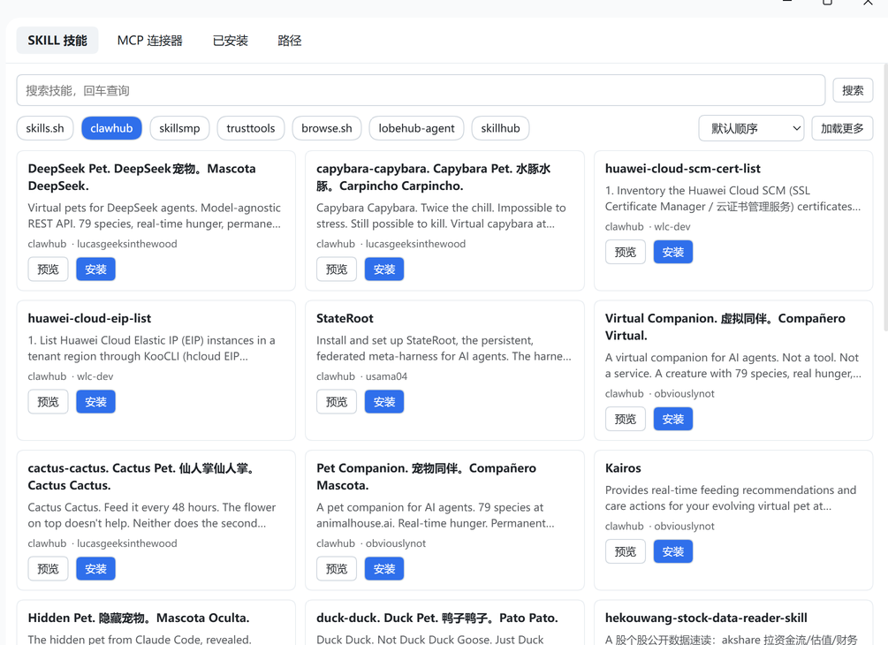

# dsh-skill-mcp-market

DSH 的**技能市场**与 **MCP 连接器市场**：浏览实时技能源、装 SKILL.md 技能、装 MCP 连接器，装完立刻能用，安装路径由你自己定，全程不用重启 DSH。

- 提供的工具：12 个 `market_* / skill_market_* / mcp_market_*`（见下表）
- 设置文件：`~/.dsh/market/settings.json`（可用 `market_set_paths` 改）
- 默认技能目录：`~/.dsh/market/skills`；默认 MCP 目录：`~/.dsh/market/mcp`
- 左侧面板：**「SKILL技能&MCP连接器」**
- 「加载更多」按钮在**当前列表最后一行的正下方居中**，SKILL 与 MCP 都显示 `加载更多（n/m）`，到底后变成 `已到最后一页（n/m）`。按钮是**真翻页**：每个源都有自己的分页（服务端 `page`，或一次性取全量目录后本地切片），8 个技能源合计约 90 万条可翻。
- 「已安装」标签两个区块（已装技能 / 已装 MCP）标题旁各加一个「打开目录」按钮
- 安装技能后**立即出现在对话框 `/` 浮窗里**（junction 注册到 `$AGENTS_HOME/skills/`）。
- skills.sh 卡片描述很简单的原因：上游目录/搜索 API **不携带描述字段**（只返回 `id/source/skillId/name/installs`），
  插件会尽力从 GitHub 的 `SKILL.md` frontmatter 读描述补上，但每条 0.3–2 秒且是尽力而为（超时/404 就留空）。
  现在「浏览」（空搜索框的首页推荐）也会补前 10 条描述。
- 切源 / 改查询现在走 **stale-while-revalidate**：命中同查询的缓存就立即渲染旧结果（提示「缓存，正在刷新…」），
  后台再刷新；不再每次切源都白屏重查。
- 「已安装」标签的技能卡片和 MCP 卡片把「详情/编辑」按钮改成了「**打开文件夹**」：点了直接在资源管理器里定位到该技能 / MCP 定义所在目录，可查看 / 编辑内容（保存即生效，无需重启 DSH）。
- 「已安装」标签顶部加一个**搜索框**，可按关键词过滤已安装的技能 / MCP（名称、描述）；清空后恢复完整列表。
- 「已安装」标签现在同时列出 **DSH 内置技能**（`$AGENTS_HOME/skills/`）+ market 安装的技能（`settings.skillDirs`）；MCP 仍只列出 market 安装的。区块标题旁会显示「含 DSH 内置 N 个目录」。：插件会往 DSH 原生扫描路径 `$AGENTS_HOME/skills/` 写一份 junction（Windows）/ symlink（其它平台），指向技能实际安装位置；DSH 的"技能目录"扫描会把它列进去，`/` 浮窗随之更新，**无需重启 DSH**。卸载时不自动清理这份 junction（避免误删用户手工放置的）。

- 「详情/编辑」改为**全屏模态**：半透明遮罩 + 居中 560px 卡片，不再在列表上方插入；右上角「关闭」按钮，或点遮罩外区域关闭；「保存」/「保存并重连」放在右下角。：点了直接在资源管理器里看 / 改（保存即生效，无需重启 DSH）；两个目录都还没配置时提示"还没有配置 … 目录"。
- trusttools 技能市场：该 API 固定返回 10 行/页（`pageSize` 参数被忽略），面板默认要 24 行 → 自动拼 3 页；搜索词命中后走 10 分钟缓存，不重复打上游。

## 截图

真机截图（DSH 桌面版，左侧菜单「SKILL技能&MCP连接器」）。

### 技能市场

顶部按来源切换（`skills.sh` / `clawhub` / `skillsmp` / `trusttools` / `browse.sh` / `lobehub-agent` / `skillhub` / `modelscope`），卡片上直接「预览 / 安装」：



> 「MCP 连接器」「已安装」「路径」三个页签的截图待补。

## 安装

已发布到 npm：**`dsh-skill-mcp-market`**（MIT，公共包，无需登录）。

### 前置条件

- 桌面版 DSH：本插件复用的是 `app.asar` 里官方技能/MCP 插件，纯 Node 环境跑不了。
- profile 目录：`~/.dsh/profiles/<profile>`，桌面版一般是 `~/.dsh/profiles/desktop`；
  Windows 下是 `C:\Users\<你>\.dsh\profiles\desktop`。

### 方式一：`dsh` CLI 安装（推荐）

DSH 桌面版自带 CLI，profile 的依赖由它**内置的 pnpm** 管理（profile 目录里有 `pnpm-lock.yaml`、`pnpm-workspace.yaml`，`nodeLinker: hoisted`）：

```bash
dsh plugin --profile desktop add dsh-skill-mcp-market
```

它等价于在 `~/.dsh/profiles/desktop` 里跑 `pnpm add`，多做了三件事：用安装目录里那份 pnpm（不依赖你本机的 pnpm）、对 profile 的 `package.json` 加文件锁（避免与正在跑的 DSH 抢写）、检查插件与当前 DSH 版本是否兼容。

`dsh` 不在 PATH 时用绝对路径：

```bat
"D:\DeepSeek Harness\resources\runtime\cli\bin\dsh.cmd" plugin --profile desktop add dsh-skill-mcp-market
```

装完依赖还差一步——**让 DSH 加载它**：把包名加进该 profile `package.json` 的 `dsh.profile.bundles`：

```json
{
  "dependencies": {
    "dsh-skill-mcp-market": "^0.3.0"
  },
  "dsh": {
    "profile": {
      "bundles": [
        "@deepseek-ai/dsh-base",
        "@deepseek-ai/dsh-web-app",
        "dsh-skill-mcp-market"
      ]
    }
  }
}
```

包自带 `dsh.bundle.patch`（指向 `cordis.patch.yml`），进了 `bundles` 就会自动插入插件行，**不用手写 `cordis.patch.yml`**。

改完 `bundles` 需要**重启一次 DSH** 让插件被加载；此后装技能、装 MCP 都不再需要重启。

> ⚠️ **两种启用方式只能选一种，不要同时用。** `dsh.profile.bundles` 里已经有包名时，**不要**再往 `cordis.patch.yml` 手写 `insert`：
> 那样同一个插件行会被挂载两次，插件管理器会在卸载时判定「其他配置仍在使用这个组合包的组件」而拒绝卸载（它先停用组合包，却仍发现同 id 的行在运行）。
>
> 只有**不想把包名放进 `bundles`**（例如只想临时试一下）时，才用下面的手写写法：

```yaml
- insert:
    - id: dsh-skill-mcp-market
      name: dsh-skill-mcp-market
      config:
        skillDirs: []
        mcpDirs: []
        shippedRoot: ""
```

用了手写 insert 的话，卸载前先把它删掉（并确认 `dsh.profile.bundles` 里没有同名包），否则会看到上面的报错。

清掉再装：`dsh plugin --profile desktop remove dsh-skill-mcp-market`（同时从 `bundles` 里删掉包名）。

### 方式二：应用内安装（plugin_manager / 插件面板）

- `plugin_manager`：`action: install_bundle`，`target` 填 `dsh-skill-mcp-market` 会「装依赖 + 加进 bundles」；`action: set_bundle` 只切换已安装包的启用状态。
- 设置 → 插件 里也能看到并启用它。
- 这条路径会执行包内代码，需要 Full access 或审批。

### 方式三：npm（不推荐）

profile 的 `node_modules` 是 pnpm 管的：`npm i` 会额外写 `package-lock.json`、打乱 `node_modules` 布局，下一次 `pnpm install` 可能把它清掉。只有在没有 `dsh` CLI 的机器上才这样装：

```bash
cd ~/.dsh/profiles/desktop
npm i dsh-skill-mcp-market      # 之后仍需把包名加入 dsh.profile.bundles
```

### 方式四：固定版本 / 多 profile / 本地开发

```bash
dsh plugin --profile desktop add dsh-skill-mcp-market@0.3.0            # 固定版本
dsh plugin --profile desktop why dsh-skill-mcp-market                  # 看装的哪个版本、谁引入的
dsh plugin --profile desktop add link:/path/to/dsh-market                       # 本地开发（换成你的仓库路径）
```

`link:` 情况下 `bundles` 里仍写包名；改完源码用 `plugin_manager set_plugin` 把 `include:dsh-skill-mcp-market` 关一次再开一次即可重挂（见「开发」）。同一个包可以装进多个 profile，各自独立配置。


### 安装/升级卡住或报 EPERM 怎么办

两种表现，同一个原因：

```
Progress: resolved 185, reused 0, downloaded 1, added 0     # 卡住不动
[ERR_PNPM_EPERM] [importPackage ...\node_modules\dsh-skill-mcp-market] EPERM: operation not permitted, rename '..._tmp_...' -> '...\dsh-skill-mcp-market'
```

pnpm 落地一个包的方式是：把解压好的 `<pkg>_tmp_xxx` **重命名覆盖** `<pkg>`。Windows 上覆盖前要先删掉旧目录，而 DSH 正加载着这个插件（模块已 import 进进程），这一步会 `EPERM`，于是安装卡住或直接失败。

**修法（实测 3.7 秒装完）**：先手动删掉目标目录，再装。

```bat
rmdir /s /q "C:\Users\<你>\.dsh\profiles\desktop\node_modules\dsh-skill-mcp-market"
dsh plugin --profile desktop add dsh-skill-mcp-market
```

也可以：先完全退出 DSH，再 `dsh plugin --profile desktop add dsh-skill-mcp-market`，装完重新启动；或者用应用内「插件」页的**更新**按钮（它会先停用再替换）。

两个坑要避开：

- **不要用 GitHub Bash / MSYS 的 `rm` 删 `link:` 形式的目录**。`node_modules\dsh-skill-mcp-market` 是指向源码仓库的符号链接，`rm` 会**跟随链接**删掉仓库里的文件（我就这样毁过一次仓库的 `.git` 元数据）。Windows 下请用 `rmdir`（只删链接本身），或在资源管理器里删除。
- 已经是最新版本时不需要再 `add`：先确认版本

```bat
node -e "console.log(require('C:/Users/<你>/.dsh/profiles/desktop/node_modules/dsh-skill-mcp-market/package.json').version)"
```

想改回"改源码即时生效"的开发模式，再执行 `dsh plugin --profile desktop add link:D:/你的仓库路径`（同样先删掉目标目录）。

### 安装后确认

1. 左侧菜单出现 **「SKILL技能&MCP连接器」**；
2. 「技能市场」「MCP 连接器」两个页签都能出卡片，顶部来源筛选可用：`skills.sh` / `clawhub` / `skillsmp` / `trusttools` / `browse.sh` / `lobehub-agent` / `skillhub` / `modelscope`；列表底部「加载更多」能翻到新条目；
3. 让模型调 `market_get_settings`，应返回两个目录、provider 挂载状态、官方包解析结果、可用来源；
4. 12 个 `market_*` / `skill_market_*` / `mcp_market_*` 工具都在。

### 首次使用：决定装到哪里

默认装在 `~/.dsh/market/` 下。想换位置（例如并入 DSH 自带技能目录，让别的 profile 也能看到）：

```
market_set_paths({ skillDirs: ["C:/Users/你/.dsh/skills"], mcpDirs: ["C:/Users/你/.dsh/market/mcp"] })
```

支持 `~`、`$DSH_HOME`、`%ENV%` 和相对 profile 的路径；改完 provider 与 MCP 立即重挂。

需要密钥的 MCP 用 `${ENV_VAR}` 占位，值放环境变量：

```json
{ "headers": { "Authorization": "Bearer ${GITHUB_TOKEN}" } }
```

### 升级与卸载

```bash
dsh plugin --profile desktop add dsh-skill-mcp-market@latest   # 升级，重启 DSH 生效
dsh plugin --profile desktop remove dsh-skill-mcp-market       # 卸载；再把这个包名从 dsh.profile.bundles 里删掉
```

卸载插件不会删掉已装好的技能与 MCP 定义（它们在 `~/.dsh/market/` 下，是独立数据）；要清理请用 `skill_market_uninstall` / `mcp_market_uninstall`。

**卸载报「其他配置仍在使用的组合包的组件，请先停用它们」** 表示插件被挂载了两次，按下面顺序修：

1. 看 profile 的 `cordis.patch.yml` 里有没有手写的 `- insert: - id: dsh-skill-mcp-market`；有就删掉这一段；
2. 确认 `dsh.profile.bundles` 里有包名 `dsh-skill-mcp-market`（这是唯一应该保留的启用方式）；
3. 重启/等热重载后，插件详情页会只剩一条插件行，卸载即可正常完成。

插件在启动时会检查这种重复挂载并在日志里告警，命中时日志形如
`[dsh-market] 检测到 2 条 id 为 dsh-skill-mcp-market 的插件行 …`。

## 为什么能"不重启就生效"

DSH 本来就有技能运行时和 MCP 运行时，缺的只是市场这一层。本插件不重造引擎，而是把两个官方插件按需挂载：

| 能力 | 做法 | 生效机制 |
|---|---|---|
| SKILL | 写 `<dir>/<name>/SKILL.md`，并挂载官方 `@deepseek-ai/dsh-skill-filesystem`（`customSkillDirs` = 用户目录，`watch: true`） | 该 provider 监听目录，文件落盘后自动失效目录缓存，下一步模型就能看见 |
| MCP | 写 `<dir>/<serverName>.json`，并用 `ctx.plugin()` 动态挂载官方 `@deepseek-ai/dsh-mcp-client` | 客户端插件把服务器工具直接注册到 `ctx.tools`，下一步即可调用 |

两个官方包从 DSH 安装目录的 `app.asar` 里按绝对路径 import（`process.resourcesPath` 自动探测，可用 `shippedRoot` 覆盖），与本进程共用同一模块实例。

## 工具一览

| 工具 | 作用 |
|---|---|
| `market_get_settings` | 看两个目录、provider 挂载状态、官方包解析结果、可用来源 |
| `market_set_paths` | 改技能/MCP 目录（支持 `~`、`$DSH_HOME`、`%ENV%`），即时重挂 provider 与 MCP |
| `skill_market_search` | 搜技能（全部实时源）：`skills.sh` / `clawhub` / `skillsmp` / `trusttools` / `browse.sh` / `lobehub-agent` / `skillhub` / `modelscope`，`all` 聚合；支持 `page` 翻页 |
| `skill_market_install` | 装技能：`github`（可带 `@ref`）/ `skills.sh`（页面 URL 或裸 `owner/repo`）/ `clawhub` / `skillsmp` / `trusttools` / `browse.sh` / `lobehub-agent` / `skillhub` / `url` / `local` / `zip` |
| `skill_market_list` | 列已装技能（含 `SKILL.md` 路径） |
| `skill_market_uninstall` | 卸载（移到 `market/trash/`） |
| `mcp_market_search` | 搜 MCP：`source: "registry"`（官方注册表，默认）或 `"lobehub"`（LobeHub 市场）；可选 `category` / `sort`（`installCount`·`ratingAverage`·`createdAt`）/ `page`；目录不可达时返回降级列表与 `catalogHint` |
| `mcp_market_install` | 装 MCP：`slug`（官方注册表名称，如 `io.github.Async23/chrome-devtools-mcp`）/ 手工定义 / `importJson`（Claude·Cursor 的 `mcpServers`），装完立即探活 |
| `mcp_market_list` | 列已装 MCP（transport、enabled、mounted、已发布工具名） |
| `mcp_market_set_enabled` | 启停（断开即撤销工具，启用即重连） |
| `mcp_market_probe` | 等 MCP 发布工具并回报 |
| `mcp_market_uninstall` | 卸载（定义移入 `.trash/`） |

## 数据源

| 源 | 说明 |
|---|---|
| **MCP 官方注册表** | `registry.modelcontextprotocol.io`，免费、实时的 MCP 目录，自带真实启动方式（npm / streamable-http） |
| **LobeHub MCP 市场** | `market.lobehub.com`，第二个 MCP 市场（面板里单独一档）。搜索走官方 `@lobehub/market-cli`，首次自动注册客户端；卡片带作者/分类/安装次数；安装取其公开 manifest 的真实启动方式 |
| `skills.sh` | 技能索引，支持页面 URL 与裸 `owner/repo`；搜索接口要求 ≥2 字符，空搜索回退到首页推荐 |
| `skillsmp` | 带反爬（Cloudflare），走 python→curl→fetch 三级取数 |
| `browse.sh` | 启动预热 + 内存缓存，冷启动超时不缓存空结果 |
| `trusttools` | `ai.trusttools.cn/api/skills/search`（POST）；该站会丢弃本进程的 TLS 握手，走 python → curl → fetch 三级通道 |
| `clawhub` / `lobehub-agent` / `skillhub` | 其余实时技能源 |
| `modelscope` | `modelscope.cn/api/v1/dolphin/skills`（PUT，`PageNumber/PageSize`，约 8.8 万条） |

**翻页**：每个源都实现了真正的 `page`——有服务端分页的直接传页（`skillsmp` / `trusttools` /
`skillhub` / `modelscope`），没有的把整份目录抓一次缓存下来再本地切片（`skills.sh` 走
`sitemap-skills-*.xml` 约 2 万条、`clawhub` 顺 `nextCursor` 累积、`browse.sh` 约 480 条、
`lobehub-agent` 约 505 个）。所以第 2 页起拿到的一定是新条目。
| `github` | 直接给仓库或 `@ref`；jsDelivr 列树失败时回退 GitHub contents API 与 codeload tarball |

## 目录结构

```
dsh-skill-mcp-market/
├─ package.json          # dsh.bundle.patch 指向 cordis.patch.yml
├─ cordis.patch.yml      # 插入一行 dsh-skill-mcp-market 插件
├─ index.js              # 插件入口：挂载 provider + 注册 12 个工具
├─ client.js             # Web 面板「SKILL技能&MCP连接器」
├─ src/
│  ├─ home.js            # 路径解析与 settings.json 读写
│  ├─ shipped.js         # 从 app.asar 解析并 import 官方插件包
│  ├─ http.js            # python→curl→fetch 三级取数（绕 TLS 指纹 / 系统代理）
│  ├─ frontmatter.js     # SKILL.md frontmatter 解析（无依赖）
│  ├─ github.js          # jsDelivr 列树 + raw/CDN 取文件，失败回退 contents API / tarball
│  ├─ extra-sources.js   # skillsmp 等额外源
│  ├─ mcp-registry.js    # MCP 官方注册表适配 + 内置兜底条目
│  ├─ skillhub.js        # SkillHub 公共 API 适配
│  ├─ skills.js          # 搜索聚合 / 安装 / 列出 / 卸载
│  ├─ sources.js         # 各源适配与缓存
│  ├─ mcp.js             # MCP 定义扫描、动态挂载、启停、探活
│  └─ ...
├─ locale/{en,zh}.json   # 插件管理器里的标题与描述
└─ icon.svg
```

## 已知边界

- DSH 的 `dsh-mcp-client` 只有 `stdio` 与 `streamable-http`，**没有 SSE**；上游只给 SSE 地址的 MCP 装不上。
- 技能发现是**一层深**：只认 `<root>/<name>/SKILL.md` 和 `<root>/<name>.md`。
- MCP 定义是标准写法，能否真跑由安装时的探活结果决定，不预先保证；注册表里标记为必填的环境变量会在安装时提示。
- 市场不伪造下载量/热度：上游没给就显示 0。
- 两个 MCP 市场**各自独立**，面板一次只看一个（和技能页签一样，不做合并）：官方注册表偏结构化启动方式，LobeHub 偏卡片信息与分类。
- LobeHub 需要注册一次市场客户端（`npx -y @lobehub/market-cli register --base-url https://market.lobehub.com --name "DSH Market" --source dsh`），插件首次使用会自动完成。
- LobeHub 页签支持分类、排序、分页（每页 40 条）；官方注册表页签支持按名称排序，分页由上游游标控制，面板暂只展示第一页。
- MCP 目录不可达时按「上次缓存 → 内置条目」降级，并在面板上提示可直接按名称安装。

## 开发

改完代码后，`plugin_manager` 无法原地替换模块。用 `plugin_manager set_plugin` 把 `include:dsh-skill-mcp-market` 关一次再开一次，新代码即生效（已在本机验证）。

冒烟脚本在 `../tools/`：`smoke-market.mjs`（技能安装/卸载、MCP 配置映射）、`smoke-market-fixes.mjs`（注册表搜索、裸 `owner/repo`、skillsmp）、`smoke-sources.mjs`（各源 provider 行为）、`smoke-demo-mcp.mjs`（MCP 协议自检）。

## 许可

MIT
